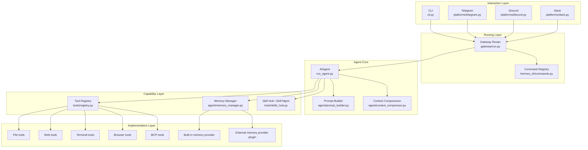
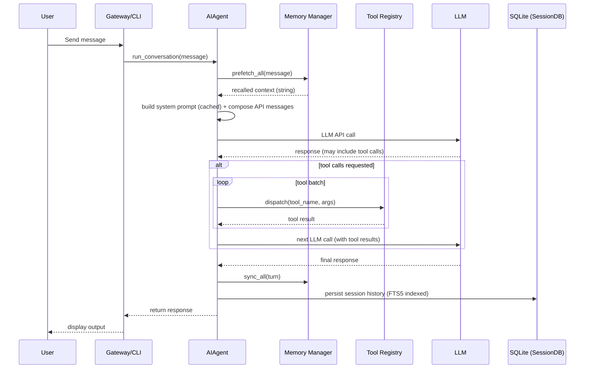
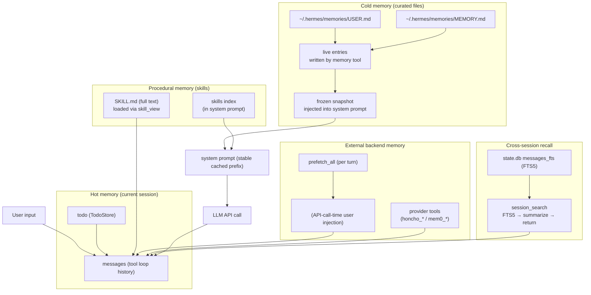

Hermes Agent is an extensible, tool-using AI runtime built around a simple but powerful idea:

**Keep the system prompt prefix stable, but make capabilities dynamic.**

That single principle drives many downstream design decisions—how prompts are built and cached, how memory is injected without polluting the core prompt, how tools are registered and executed, and how Hermes can scale from a CLI experience to multi-platform gateways (Slack, Telegram, Discord) without forking the core agent loop.

This post is a hands-on technical walkthrough of Hermes Agent’s architecture, agent loop, memory system, self-improvement mechanics, subagent delegation, and extensibility. It’s written for engineers who want to understand “how it really works” and what you can build on top of it.

---

## Architecture: A Layered Runtime, Not a Monolith

Hermes is structured in layers:

- **Interaction layer**: where user messages originate (CLI, Telegram, Slack, Discord)
- **Routing layer**: gateway logic that normalizes and dispatches messages
- **Agent core**: the `AIAgent` tool loop, prompt assembly, context compression
- **Capability layer**: tool registry, memory orchestration, skills management
- **Implementation layer**: concrete tool backends and external providers

Here’s a simplified map:



**Why this matters:** Hermes is “agent-core + registries + plugins.” The agent loop stays stable while the capabilities around it evolve.

---

## The Agent Loop: Tool-Using Iterations with Stable Prompt Prefix

At runtime, Hermes executes a classic tool-using loop:

1. Receive message (from gateway or CLI)
2. (Optional) prefetch recall context from external memory backend
3. Build **system prompt** (cached) + **ephemeral per-call context**
4. Call LLM
5. If LLM requests tools, dispatch tools and loop
6. Persist session history and sync memory providers

A high-level sequence looks like this:



The “stable prompt prefix” principle is key here: Hermes tries hard to avoid mutating the cached system prompt across turns.

---

## Memory: Five Layers, Each with a Different Job

A frequent misconception: “If it’s in sessions, it’s memory.” Hermes is much more intentional.

Hermes effectively has **five cooperating memory-like layers**:

1. **Hot memory**: `messages` + `todo` (current session working state)
2. **Cold curated file memory**: `MEMORY.md` / `USER.md` (snapshot-injected into system prompt)
3. **Procedural memory**: skills (`SKILL.md`) — indexed in system prompt, loaded on demand
4. **External memory backend**: MemoryProvider plugins (Honcho, Mem0, …) with per-turn recall
5. **Cross-session recall**: SessionDB + FTS5 via `session_search` (retrieve then summarize)

Here’s how they coordinate without contaminating each other:



### Why some memory goes into the system prompt and others don’t

Hermes injects curated file memory as a **frozen snapshot** at session start:

```1:14:/Users/gyliu-cary/go/src/github.com/NousResearch/hermes-agent/tools/memory_tool.py
Both are injected into the system prompt as a frozen snapshot at session start.
Mid-session writes update files on disk immediately (durable) but do NOT change
the system prompt -- this preserves the prefix cache for the entire session.
The snapshot refreshes on the next session start.
```

That’s a deliberate tradeoff:

- **Pros:** stable system prompt → better caching → lower repeated token cost
- **Con:** memory written mid-session becomes durable immediately but appears in system prompt next session

External recall (Honcho/Mem0) is injected at **API-call time** into the current user message (wrapped in a fenced `<memory-context>` block), keeping the system prompt stable.

---

## Self-Improvement: Durable Outcomes Without Training

Hermes “gets better” without training the model by turning successful work into durable artifacts:

- **Facts/preferences** → `memory` → `USER.md` / `MEMORY.md`
- **Reusable workflows** → `skill_manage` → `SKILL.md`
- **Past decisions** → `session_search` → FTS5 retrieval + summarization

### Background Review Agent: “don’t forget to save”
Hermes can spawn a background reviewer agent that replays a conversation snapshot and decides whether to save memory or create/update skills:

```2448:2494:/Users/gyliu-cary/go/src/github.com/NousResearch/hermes-agent/run_agent.py
review_agent = AIAgent(
    model=self.model,
    max_iterations=8,
    quiet_mode=True,
    platform=self.platform,
    provider=self.provider,
)
review_agent._memory_store = self._memory_store
review_agent._memory_enabled = self._memory_enabled
review_agent._user_profile_enabled = self._user_profile_enabled
review_agent._memory_nudge_interval = 0
review_agent._skill_nudge_interval = 0

review_agent.run_conversation(
    user_message=prompt,
    conversation_history=messages_snapshot,
)
```

This reviewer:
- does **not** modify the main conversation history
- writes directly to shared memory/skill stores
- exits when finished

---

## Skills: Indexing, Creation, Cache Invalidation, and Triggers

Skills are Hermes’s procedural memory. They’re stored as `SKILL.md` files (plus optional references/templates/scripts/assets). Hermes injects a **skills index** into the system prompt (names + short descriptions), and loads full content via `skill_view` on demand.

### Why skill index cache is cleared after skill writes
Hermes caches the skills index with a two-layer system (in-process LRU + on-disk snapshot). After any successful skill mutation, it clears caches so the next prompt index reflects current skills.

```667:671:/Users/gyliu-cary/go/src/github.com/NousResearch/hermes-agent/tools/skill_manager_tool.py
clear_skills_system_prompt_cache(clear_snapshot=True)
```

### How skills are created
A new skill is created only by calling:

`skill_manage(action="create", name="...", content="full SKILL.md", category=optional)`

Creation writes a new directory and `SKILL.md` atomically, then security scans and rolls back if blocked.

```304:345:/Users/gyliu-cary/go/src/github.com/NousResearch/hermes-agent/tools/skill_manager_tool.py
skill_dir = _resolve_skill_dir(name, category)
skill_dir.mkdir(parents=True, exist_ok=True)
skill_md = skill_dir / "SKILL.md"
_atomic_write_text(skill_md, content)

scan_error = _security_scan_skill(skill_dir)
if scan_error:
    shutil.rmtree(skill_dir, ignore_errors=True)
    return {"success": False, "error": scan_error}
```

### When skill creation is triggered
There’s no always-on “auto skill writer.” Skills are created only when `skill_manage(action="create")` is invoked, via:

1) **Direct:** user asks or model decides proactively  
2) **Indirect:** tool-heavy turn crosses nudge threshold → background review agent may create/update a skill  
   - Hermes increments a counter per tool-loop iteration and checks the threshold at the end of the turn; if reached, it triggers background review.

---

## Task Decomposition & Dynamic Agent Creation (Subagents)

Hermes does not have a hard-coded task planner service. Decomposition is LLM-driven, with `todo` as an in-session plan tracker.

For parallel or isolated workstreams, Hermes supports dynamic subagents via `delegate_task`.

- Subagents are created on-demand (only when `delegate_task` runs)
- Subagents are closed when finished (resource cleanup)

Creation:

```376:409:/Users/gyliu-cary/go/src/github.com/NousResearch/hermes-agent/tools/delegate_tool.py
child = AIAgent(
    quiet_mode=True,
    ephemeral_system_prompt=child_prompt,
    log_prefix=f"[subagent-{task_index}]",
    skip_context_files=True,
    skip_memory=True,
    clarify_callback=None,
)
```

**Important constraints:**
- subagents start with fresh context (no parent history)
- restricted tool access
- no recursive delegation beyond a depth cap

---

## Extensibility: Plugins + MCP + Community Skills

Hermes is built to be extended through supported surfaces:

- **Plugins**: register tools, hooks, commands, namespaced skills
- **MCP servers**: external tool providers configured in `~/.hermes/config.yaml`
- **Skills**: user-level extensibility and community install flow (`/skills`)

Example MCP config:

```yaml
mcp_servers:
  filesystem:
    command: "npx"
    args: ["-y", "@modelcontextprotocol/server-filesystem", "/tmp"]
  remote_api:
    url: "https://my-mcp-server.example.com/mcp"
```

---

## Closing: Why This Design Works

Hermes scales to long-running, tool-heavy conversations because it separates stable and unstable context:

- **Stable core:** cached system prompt + curated memory snapshot + skill index
- **Ephemeral additions:** external recall injected at API-call time into user message
- **Durable improvements:** preferences to `USER.md`, workflows to skills, searchable history in SessionDB (FTS5)
