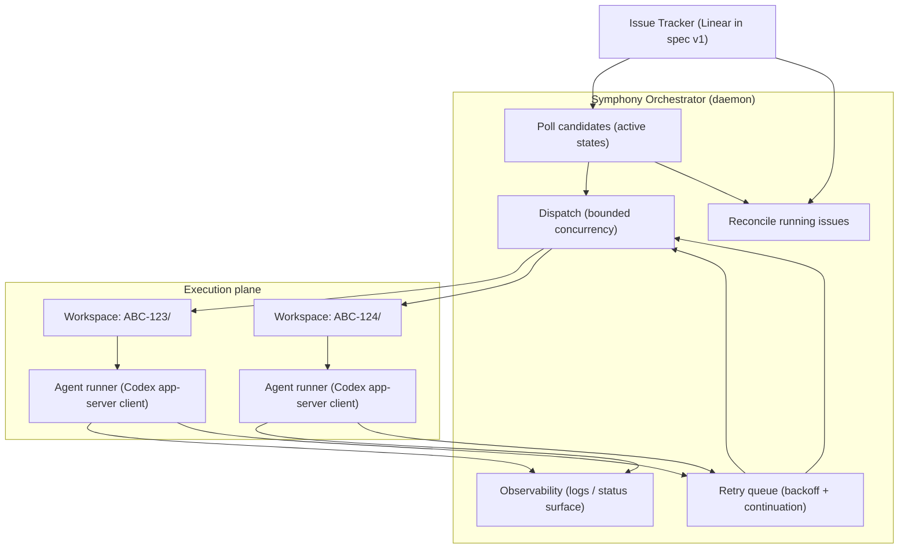
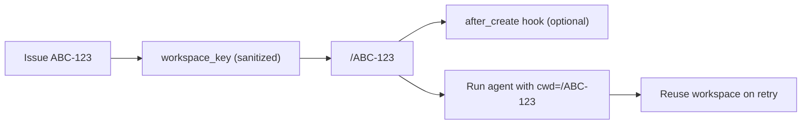
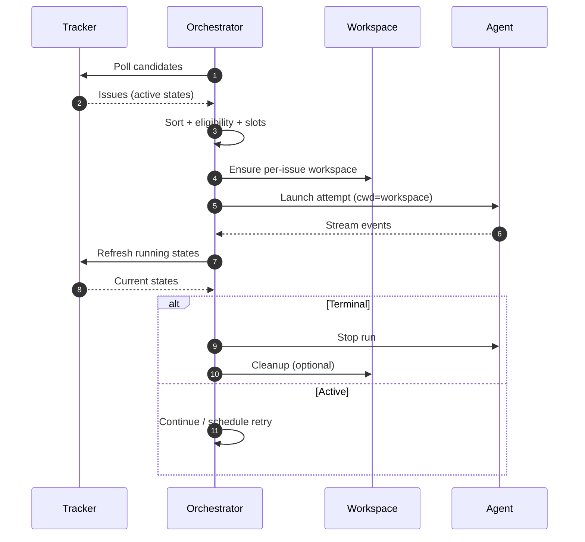
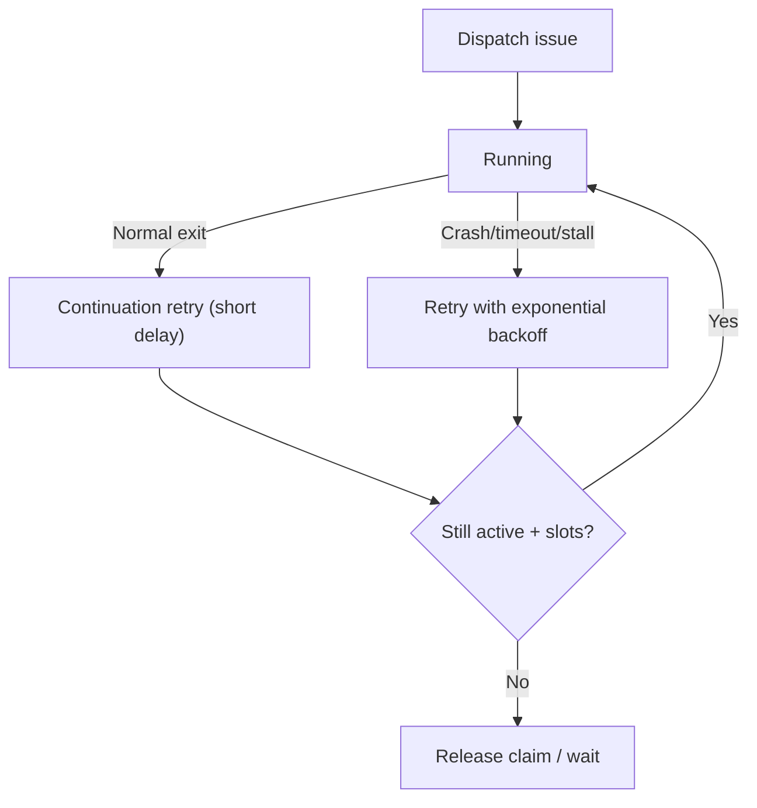
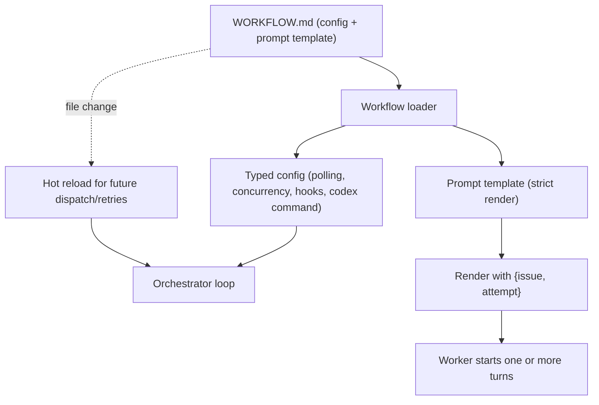
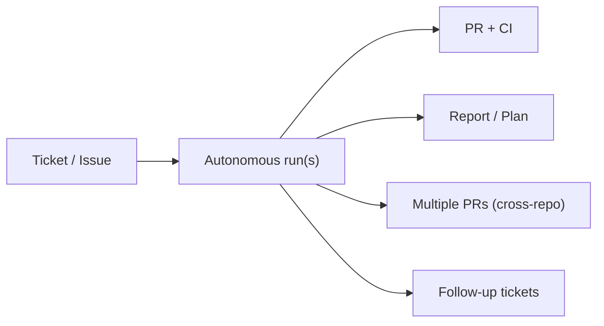

Interactive coding agents are fast, but interactive **sessions** don’t scale. In practice, most engineers can comfortably supervise only a handful of parallel sessions before context switching becomes the bottleneck: you forget which session is doing what, you keep nudging stalled runs, and you end up “managing tabs” more than shipping code.

**Symphony** reframes the unit of work. Instead of asking humans to manage individual agent sessions, it turns an issue tracker (Linear in the v1 spec) into a **control plane** that continuously dispatches and supervises autonomous agent runs at the **ticket** level.

This post explains Symphony from a technical angle: what it is, what it is not, and the minimal mechanisms that make it operationally viable—**per-issue workspaces**, a **poll/dispatch/reconcile loop**, **retry/backoff**, and **workflow-as-code** via `WORKFLOW.md`.

---

## What Symphony is (and isn’t)

**Symphony is not a new coding agent.** It is a **language-agnostic specification** for a long-running orchestration service that:

- Continuously reads work from an issue tracker (Linear in spec v1)
- Creates an isolated **per-issue workspace**
- Runs a coding agent session inside that workspace
- Adds the operational plumbing you need at scale: bounded concurrency, reconciliation, retries, and observability

The spec draws an important boundary (worth stating explicitly in any technical write-up):

- **Symphony is a scheduler/runner and tracker reader.**
- **Ticket writes** (state transitions, comments, PR links) are **typically performed by the coding agent** using tools available in the workflow/runtime environment.

This boundary keeps the orchestrator core small and portable. Your team’s policy lives in a repo-owned workflow contract, not hard-coded in the orchestrator.

---

## Architecture: issue tracker as control plane

At a high level, Symphony splits “control” from “execution”:

The key shift is **where humans spend attention**:

- Old world: people supervise sessions directly (interactive steering, mid-flight nudges, manual retries).
- Symphony world: people manage **work state** in the tracker; the orchestrator manages the execution loop.

---

## Core mechanism #1: per-issue workspaces

Per-issue workspaces are both an operational and safety primitive:

- **Isolation**: agent commands run in an issue-scoped directory, not in your main repo checkout.
- **Reproducibility**: workspace state persists across attempts, enabling “resume” behavior on retries/continuations.
- **Safety invariants**: workspace keys are sanitized; workspace paths must remain under a configured root.

One subtle but important design choice: **the spec does not mandate a particular VCS workflow**. Cloning, syncing, dependency bootstrapping, and other “make workspace runnable” steps are typically handled via hooks defined in `WORKFLOW.md`.

---

## Core mechanism #2: poll → dispatch → reconcile

Symphony orchestration is intentionally “boring” (in a good way): a fixed-cadence polling loop plus reconciliation.

- **Poll**: fetch candidate issues in configured active states.
- **Dispatch**: select eligible issues, bounded by concurrency limits, then launch workers.
- **Reconcile**: continuously re-check tracker state and stop runs that became ineligible.

Reconciliation is what makes the system robust at scale: it aligns “what is running” with “what should be running,” even when ticket state changes out-of-band (a human moves a ticket, a dependency gets unblocked, etc.).

---

## Core mechanism #3: retry/backoff + stall detection

Autonomous runs will fail: subprocess crashes, flaky tests, transient network errors, or model stalls. Symphony makes failure a first-class state with clear recovery paths:

- **Stall detection**: if no agent activity is observed for longer than `stall_timeout_ms`, terminate and retry.
- **Continuation retries**: after every normal worker exit, the orchestrator always schedules a short “continuation retry” (~1 second) to re-check whether the issue is still active and needs another worker session.
- **Exponential backoff**: abnormal exits schedule retries with backoff, capped by a configurable maximum.

This is the core reason Symphony can run “always on”: it doesn’t need humans to notice and restart stuck work.

---

## Core mechanism #4: workflow-as-code via `WORKFLOW.md`

Symphony keeps workflow policy in-repo, versioned with the codebase. The contract is `WORKFLOW.md`, typically containing:

- YAML front matter for runtime settings (poll interval, concurrency, workspace root, hooks, agent command)
- Markdown prompt template rendered per issue (with strict variable checking)

Two practical implications:

- **Operational steering becomes a repo change**: you can adjust the prompt, tool posture, or hooks via PR.
- **Hot reload** is part of the spec: changes to `WORKFLOW.md` must be re-applied at runtime (without restart) for future scheduling decisions and future runs.

---

## Outputs: proof-of-work, not “always a PR”

It’s tempting to describe Symphony as an “issue-to-PR pipeline.” That’s often the common case, but the spec and the OpenAI post emphasize a broader framing:

- Some tickets produce **multiple PRs** (even across repos).
- Some tickets produce **analysis or a plan** and never touch code.
- Agents can file **follow-up tickets** when they discover out-of-scope improvements.

The orchestrator’s job is to keep the work moving and provide enough visibility for humans to review. What “done” means is workflow-defined: a successful run can end at a handoff state like **Human Review**, not necessarily **Done**.

---

## When Symphony shines (and when it doesn’t)

Symphony is most effective when the bottleneck is **coordination and attention**, not raw model capability.

**Best fit**

- Routine implementation work: small bug fixes, dependency upgrades, test additions
- CI shepherding: flaky checks, last-mile landings, conflict resolution loops
- Large monorepos where PR landing is slow and fragile
- High-volume “background” work where humans mainly want review packets and confidence signals

**Not a great fit**

- Work that needs constant interactive steering and mid-flight human judgment
- Environments without a strong harness (tests/guardrails) or a clearly documented trust & safety posture
- High-risk tasks where you need strict sandboxing/approvals but haven’t built the harness to support it

---

## Closing: from supervising sessions to managing work

Symphony’s real move is a workflow inversion:

- Stop optimizing for “how many sessions can I run at once?”
- Optimize for “how much work can the system keep moving with minimal human attention?”

Treat the issue tracker as the control plane, keep runs isolated and retryable, encode policy in `WORKFLOW.md`, and push humans up the stack to where they add the most value: **review and decisions**, not babysitting.

---

## Reference
- [OpenAI post](https://openai.com/index/open-source-codex-orchestration-symphony/)
- [GitHub repo](https://github.com/openai/symphony)
- [OpenAI Symphony SPEC.md](https://github.com/openai/symphony/blob/main/SPEC.md)