*Written for readers who want to understand LLM inference infrastructure. No prior knowledge of inference engine internals is assumed. The llm-d examples are based on the `main` branch of [llm-d-router](https://github.com/llm-d/llm-d-router) as of November 2026.*

## Contents

1. Background: what the KV cache is and why it matters
2. Architecture: the layers of a KV cache system
3. How it works: prefix fingerprints, cache-aware routing, and P/D disaggregation
4. Use cases
5. Benefits and costs
6. Enabling KV-cache-aware routing in llm-d (example)
7. Summary

---

## 1. Background

### 1.1 LLMs generate one token at a time

Large language models generate text **autoregressively**: they predict one next token, append it to the sequence, predict the next one, and repeat until done.

The core of the model is the attention mechanism. To generate token t, every layer combines the Query vector of the current token with the Key and Value vectors of **all previous tokens**. The K and V vectors of earlier tokens never change in later steps, so they can be computed once and stored, and each step then only computes K and V for the new token. The stored vectors are the **KV cache**.

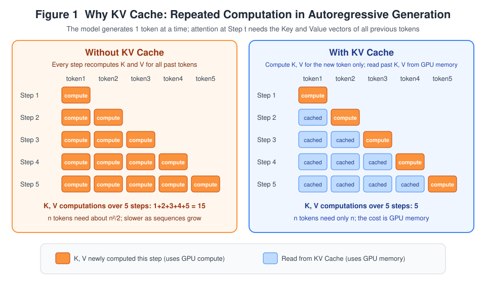

In Figure 1, generating 5 tokens without a KV cache computes K and V 15 times, and n tokens take about n²/2 computations. With a KV cache it takes only n. The cost is that these K and V vectors must stay in GPU memory.

### 1.2 Two phases of a request: Prefill and Decode

An inference request runs in two phases:

- **Prefill**: the whole prompt goes through the model in one parallel pass. K and V are computed for every prompt token and written to the KV cache, and the first output token is produced. This phase is compute-bound and determines the **time to first token (TTFT)**.
- **Decode**: one token is generated per iteration. Each iteration reads all previous K and V and appends the new token's K and V. This phase is bound by memory bandwidth and determines the **time per output token (TPOT)**.

Inference engines such as vLLM and SGLang do not give each request one contiguous region of GPU memory. They split the KV cache into fixed-size **blocks** (16 tokens per block by default in vLLM) and manage them the way an operating system manages memory pages. This is **PagedAttention**, introduced by vLLM.

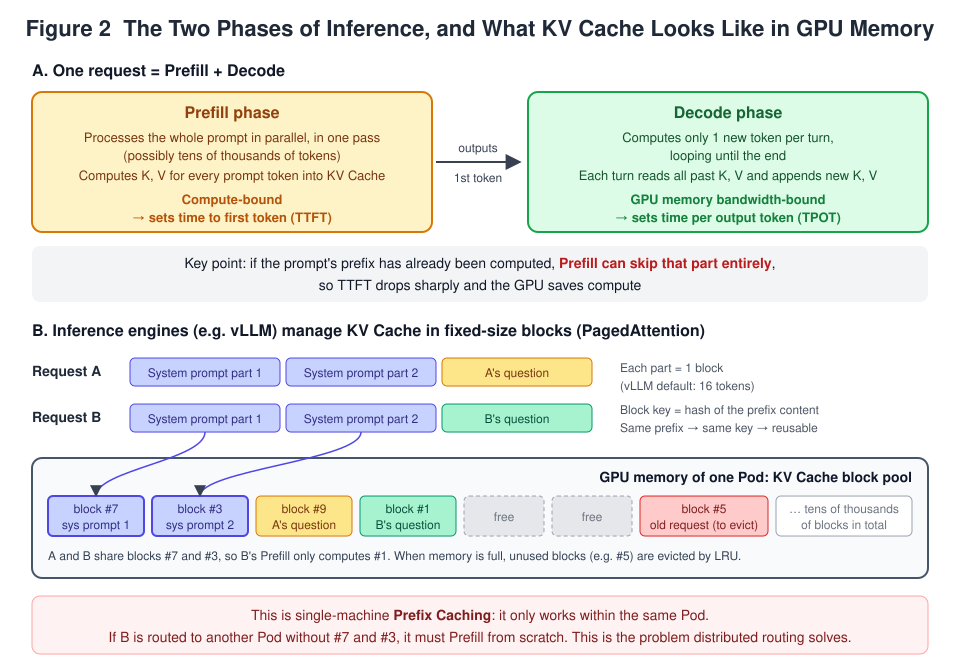

Blocks make **prefix caching** possible inside the engine: when two requests start with the same content (for example the same system prompt), the matching blocks are shared, and the second request only needs to prefill the part that is unique to it. This only works **within a single inference instance**.

### 1.3 How big is the KV cache

The KV size per token can be estimated as:

```
KV bytes per token = 2 (K and V) × layers × KV heads × head dimension × bytes per value
```

For Llama-3-70B: 80 layers, 8 KV heads (GQA), head dimension 128, and FP16 at 2 bytes per value:

```
2 × 80 × 8 × 128 × 2 = 327,680 bytes ≈ 320 KB per token
```

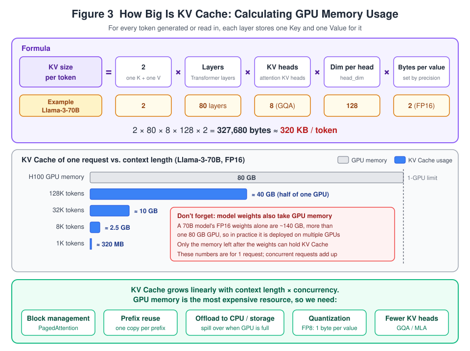

A single 128K-token request needs about 40 GB, while an H100 has 80 GB and must also hold the model weights. Total KV cache size is context length multiplied by concurrency, so GPU memory becomes the bottleneck quickly. The industry has developed several techniques in response: block-based management (PagedAttention), prefix reuse, offloading to CPU memory or storage, low-precision quantization such as FP8, and model architectures with fewer KV heads such as GQA and MLA.

### 1.4 From one server to a cluster: where should the request go

In production a model usually runs as several replicas. Traditional load balancing (round robin, random, least connections) does not know what each replica has cached. Consecutive turns of the same conversation can land on different replicas and prefill from scratch every time.

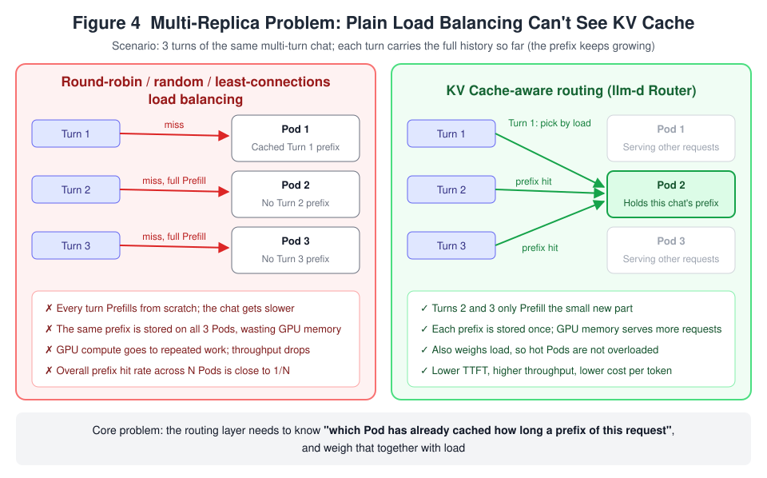

With N replicas, random routing gives a prefix hit rate of roughly 1/N, and the same prefix is stored separately on several replicas. To fix this, the routing layer must know **which replica already caches how much of this request's prefix**, and weigh that against load. This is **KV-cache-aware routing**, one of the core capabilities of distributed inference systems such as llm-d.

---

## 2. Architecture

### 2.1 Three layers

Putting the single-server mechanisms and cluster scheduling together, a KV cache system has three layers:

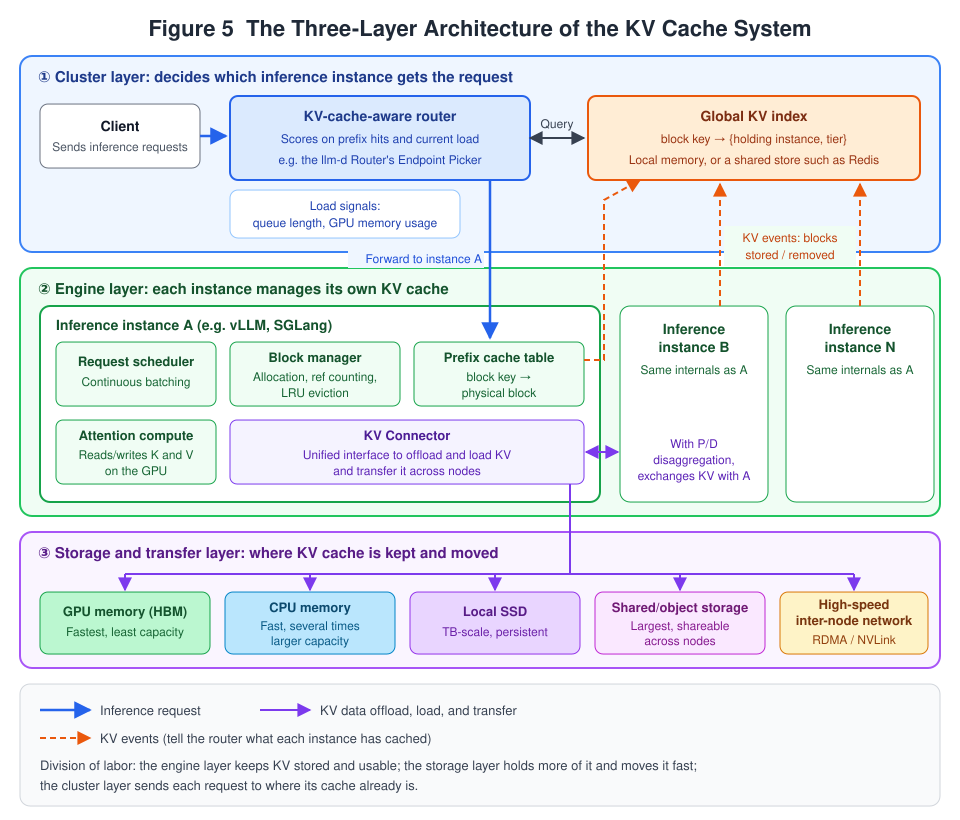

| Layer | Responsibility | Typical components |
|---|---|---|
| ① Cluster | Decide which inference instance serves the request, sending it to where the cache is | KV-cache-aware router (for example the Endpoint Picker in llm-d Router), global KV index |
| ② Engine | Allocate, reuse, and evict KV blocks inside one instance, and publish cache changes | vLLM / SGLang block manager, prefix cache table, KV Connector |
| ③ Storage and transfer | Where KV data is stored and how it moves | GPU memory, CPU memory, local SSD, shared / object storage, RDMA / NVLink networks |

Two kinds of data connect the layers:

- **KV events** (dashed orange): the engine layer tells the cluster layer which blocks it stored or removed, and the cluster layer keeps its global index up to date.
- **KV data** (purple): moved by the KV Connector between GPU memory and lower storage tiers, or between nodes.

This architecture does not depend on Kubernetes. In llm-d, inference instances can be discovered by watching Kubernetes Pods, or by reading an endpoints file with `file-discovery`, which works on bare metal, virtual machines, and other non-Kubernetes environments.

### 2.2 Tiered storage (offloading)

GPU memory is the fastest tier and the smallest. Offloading evicted blocks to larger, cheaper tiers and loading them back on a later hit turns the KV cache into a multi-level cache:

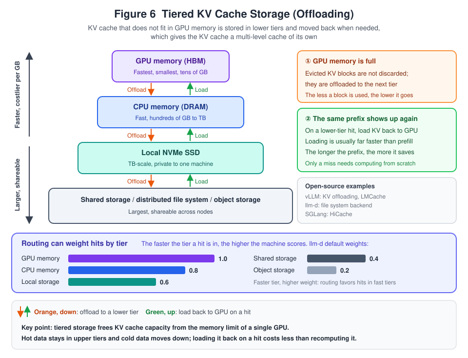

Loading KV from a lower tier is usually faster than running Prefill again, and the gap grows with prefix length. Open source implementations include vLLM KV offloading and LMCache, SGLang HiCache, and the llm-d file system backend (`llmd_fs_backend` in the `llm-d-kv-cache` repository).

For routing, a hit also depends on the tier: a block in GPU memory is usable immediately, while a block in shared storage must be loaded first. llm-d weights tiers by default as GPU 1.0, CPU 0.8, local storage 0.6, shared storage 0.4, and object storage 0.2.

### 2.3 How the router knows what each instance has cached

There are two approaches:

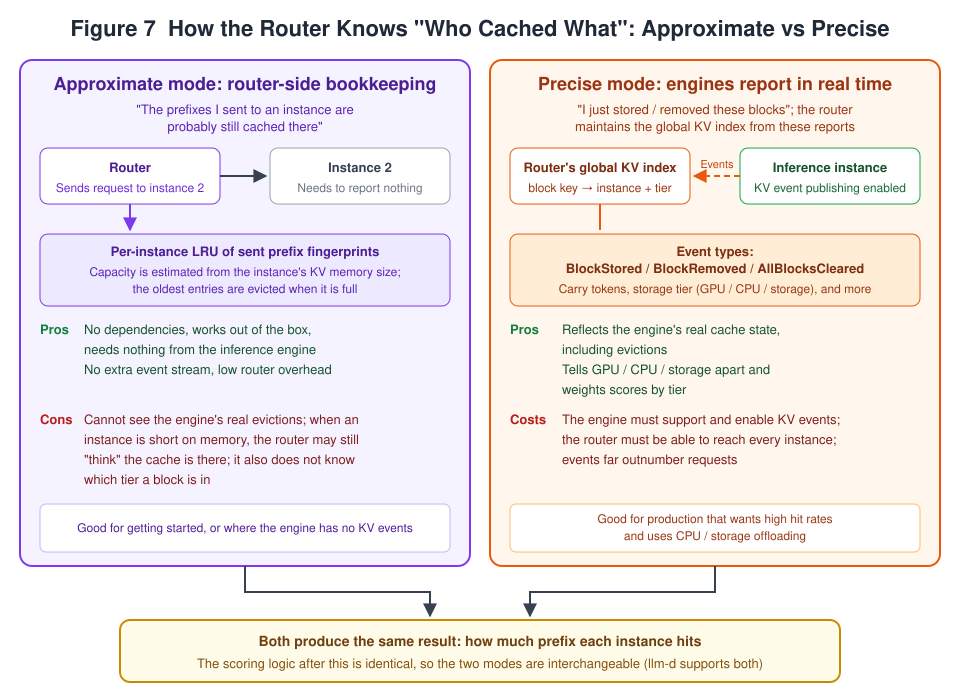

| | Approximate mode | Precise mode |
|---|---|---|
| Source of information | The router records which prefixes it sent to which instance | The inference engine reports KV events in real time |
| Engine requirements | None | Must support and enable KV events (vLLM and SGLang do) |
| Sees evictions | No, estimates with an LRU sized to capacity | Yes |
| Knows the storage tier | No | Yes, scores are weighted per tier |
| Extra overhead | Small | Subscribes to every instance's event stream; events far outnumber requests |
| llm-d implementation | `approx-prefix-cache-producer` (default) | `precise-prefix-cache-producer` |

Both modes produce the same result (how much prefix each instance holds) and feed the same scoring logic, so you can switch between them per environment.

---

## 3. How it works

### 3.1 Prefix fingerprints: turning tokens into block keys

The router cannot compare whole prompts against every instance token by token. Like the inference engine, it splits the token sequence into blocks and applies a **chained hash**:

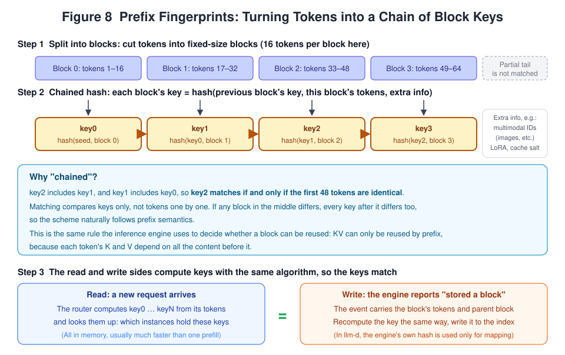

- Each block's key = hash(previous block's key, this block's tokens, extra information). Extra information includes multimodal content identifiers such as images, LoRA, and the cache salt used for tenant isolation.
- Because the hash is chained, equal key i means the first i blocks are identical. This matches the rule that KV can only be reused by prefix: each token's K and V depend on everything before it, so changing one word invalidates all KV after it.
- The read path (a new request looking up the index) and the write path (the engine reporting events) compute keys with the same algorithm, which is what lets them match. In llm-d precise mode the router recomputes keys from the tokens carried in each event and uses the engine's own hashes only as a mapping, so the router's block size and hash seed do not need to match the engine's.

### 3.2 End-to-end flow of one request

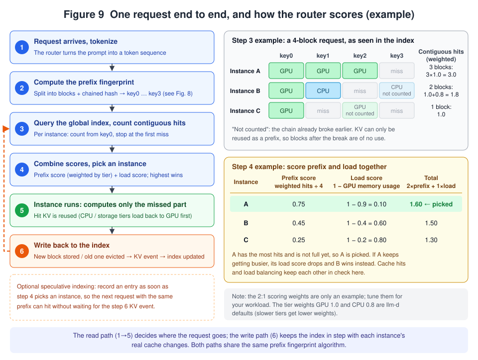

1. **Request arrives and is tokenized**: the router turns the prompt into a token sequence.
2. **Compute prefix fingerprints**: split into blocks and chain-hash them into key0 … keyN.
3. **Look up the global index**: for each instance, count consecutive hits starting at key0 and stop at the first miss. In the figure, instance C holds key2, but key1 is missing, so key2 does not count.
4. **Score**: combine the prefix score (tier-weighted matched blocks ÷ total blocks) with load scores (for example 1 − KV memory utilization, or queue length), and pick the instance with the highest total. Looking only at the cache would pile every popular prefix onto one instance, so load has to be part of the score.
5. **Instance runs the request**: the selected instance only prefills the part that missed. Blocks that hit in CPU memory or storage are loaded back to the GPU first.
6. **Update the index**: when the instance stores new blocks or evicts old ones it emits KV events, and the router updates the index.

Some engineering details:

- **Events lag behind**: there is a gap between the routing decision and the arrival of the KV events. A request with the same prefix that arrives right after may not find a hit yet. llm-d speculative indexing records the decision as soon as step 4 picks an instance (expiring after 2 seconds by default) until real events confirm it.
- **Events get lost**: an engine restart or network interruption can leave the index out of sync with reality. llm-d can replay missed events through a replay port, or rebuild from the instance's full current cache state through a snapshot port (snapshots are currently experimental).
- **Multiple router replicas**: the router itself must be highly available. Putting the global index in shared storage such as Redis lets several router replicas see the same index.

### 3.3 The KV cache in P/D disaggregation

Prefill is compute-bound and Decode is memory-bandwidth-bound, so running both on the same instance makes them interfere: one long prompt's Prefill slows down every request decoding on that instance. **Prefill/Decode (P/D) disaggregation** runs the two phases on different nodes, and the KV cache is the data handed over between them:

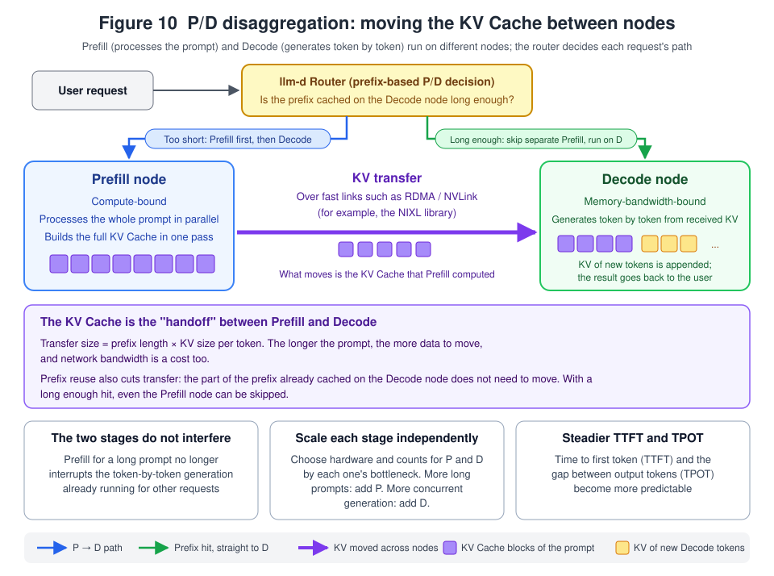

- The Prefill node computes the full KV cache and sends it to the Decode node over a fast network such as RDMA or NVLink (for example with the NIXL library).
- The transfer size is prefix length times per-token KV size, so long prompts carry a real network cost.
- Prefix reuse helps here too. If the Decode node already caches a long enough prefix, the router can let the Decode node handle the whole request and skip the separate Prefill step. In llm-d this decision is made by `prefix-based-pd-decider`.

---

## 4. Use cases

The benefit of KV cache reuse comes from **long prefixes shared across requests**:

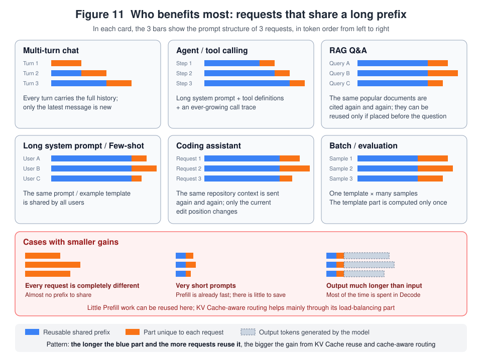

| Use case | Shared prefix | Notes |
|---|---|---|
| Multi-turn chat | All previous turns | Each turn only adds the last message, so the shared share grows over time |
| Agents / tool calling | Long system prompt + tool definitions + call trajectory | One task calls the model many times with a growing prefix |
| RAG question answering | Popular document chunks | Documents must come before the question for the prefix to be reusable |
| Long system prompts / few-shot | A template shared by all users | The longer the template, the larger the gain |
| Coding assistants | Context from the same repository | Only the current edit location changes |
| Batch processing / evaluation | One template × many samples | The template part is computed once |

Gains are small when every request is different, prompts are short, or output is much longer than input (most time is spent in Decode). In those cases KV-cache-aware routing helps mainly through its load-balancing part.

A general prompt design rule follows from this: **put stable content first and changing content last**. System prompts, tool definitions, and documents go at the start; the user's question goes at the end. Values that change on every request, such as timestamps or request IDs, placed at the start make everything after them unreusable.

---

## 5. Benefits and costs

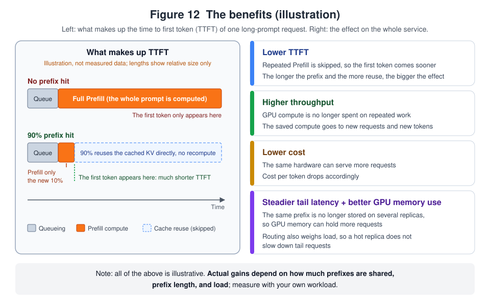

**Benefits:**

- **Lower TTFT**: repeated Prefill is skipped; longer and more frequently reused prefixes gain more.
- **Higher throughput**: GPU compute is no longer spent recomputing the same prefixes and goes to new requests.
- **Lower cost**: the same hardware serves more requests, so cost per token drops.
- **More stable tail latency and better memory use**: one prefix is no longer stored on several replicas, and because routing also weighs load, no single replica becomes a hot spot.

**Costs and caveats:**

- **Cache affinity and load balance must be traded off**: weighting the cache too heavily creates hot spots; weighting load too heavily lowers the hit rate. Tune the scoring weights to real traffic.
- **Precise mode adds operational work**: engines must enable KV events, the router must reach every instance's event port, and events far outnumber requests.
- **The index lags reality**: speculative indexing, event replay, and snapshot recovery are needed as safeguards.
- **Multi-tenant isolation**: by default, identical prefixes from different tenants share KV. To isolate them, add a cache salt to requests so the same content produces different keys per tenant.
- **Real gains depend on the workload**: prefix sharing, prefix length, and load all affect results. Measure with your own traffic before rollout.

---

## 6. Enabling KV-cache-aware routing in llm-d (example)

**Approximate mode** needs no extra configuration: when the scheduling configuration uses `prefix-cache-scorer` without naming a data source, llm-d creates `approx-prefix-cache-producer` automatically.

**Precise mode** takes two steps.

Step 1: have vLLM publish KV events (one ZMQ publisher port per instance; the topic carries the instance address and the model name):

```bash
vllm serve <model> \
  --kv-events-config '{"enable_kv_cache_events":true,"publisher":"zmq","endpoint":"tcp://*:5557","topic":"kv@${POD_IP}:8000@<model>"}'
```

Step 2: configure the Endpoint Picker to use the precise data source and point `prefix-cache-scorer` at it. Precise mode needs tokenization that matches vLLM exactly, so `token-producer` must tokenize through vLLM's `/render` endpoint instead of the default estimating backend:

```yaml
apiVersion: llm-d.ai/v1
kind: EndpointPickerConfig
plugins:
- type: token-producer
  parameters:
    modelName: meta-llama/Llama-3.1-8B-Instruct
    vllm:
      url: http://vllm-render:8000
- type: precise-prefix-cache-producer
- type: prefix-cache-scorer
  parameters:
    prefixMatchInfoProducerName: precise-prefix-cache-producer
- type: kv-cache-utilization-scorer
- type: max-score-picker
- type: single-profile-handler
schedulingProfiles:
- name: default
  plugins:
  - pluginRef: prefix-cache-scorer
    weight: 2
  - pluginRef: kv-cache-utilization-scorer
    weight: 1
  - pluginRef: max-score-picker
```

For SGLang, set `engineType` to `sglang` in `kvEventsConfig`. See each plugin's README in the llm-d-router repository for the full parameter reference (links in the references below).

---

## 7. Summary

- The KV cache trades GPU memory for compute: storing computed K and V avoids recomputing the whole history for every new token.
- Inference engines use block-based management (PagedAttention) and prefix caching so requests with the same prefix share KV, and tiered storage extends capacity to CPU memory and storage.
- With multiple replicas, prefix caching only pays off when requests reach the instance that holds the cache. KV-cache-aware routing does this with prefix fingerprints and a global index, scored together with load.
- In P/D disaggregation the KV cache is the data handed from Prefill to Decode, and prefix reuse cuts both compute and transfer.
- The biggest wins come from long prefixes shared across requests: multi-turn chat, agents, RAG, long system prompts, and similar workloads.

---

## References

- vLLM paper: Efficient Memory Management for Large Language Model Serving with PagedAttention (SOSP 2023), https://arxiv.org/abs/2309.06180
- vLLM Automatic Prefix Caching: https://docs.vllm.ai/en/latest/design/prefix_caching.html
- llm-d-router (links pinned to commit `c01ba399`, November 2026)
  - KV-Cache Indexer: [`pkg/kvcache/README.md`](https://github.com/llm-d/llm-d-router/blob/c01ba3994606ac4f0d312386f4b95a3992f81c66/pkg/kvcache/README.md)
  - KV-Block Index: [`pkg/kvcache/kvblock/README.md`](https://github.com/llm-d/llm-d-router/blob/c01ba3994606ac4f0d312386f4b95a3992f81c66/pkg/kvcache/kvblock/README.md)
  - KV-Events: [`pkg/kvevents/README.md`](https://github.com/llm-d/llm-d-router/blob/c01ba3994606ac4f0d312386f4b95a3992f81c66/pkg/kvevents/README.md)
  - Precise Prefix Cache Producer: [`pkg/epp/framework/plugins/requesthandling/dataproducer/preciseprefixcache/README.md`](https://github.com/llm-d/llm-d-router/blob/c01ba3994606ac4f0d312386f4b95a3992f81c66/pkg/epp/framework/plugins/requesthandling/dataproducer/preciseprefixcache/README.md)
  - Approximate Prefix Cache Producer: [`pkg/epp/framework/plugins/requesthandling/dataproducer/approximateprefix/README.md`](https://github.com/llm-d/llm-d-router/blob/c01ba3994606ac4f0d312386f4b95a3992f81c66/pkg/epp/framework/plugins/requesthandling/dataproducer/approximateprefix/README.md)
  - Prefix Cache Scorer: [`pkg/epp/framework/plugins/scheduling/scorer/prefix/README.md`](https://github.com/llm-d/llm-d-router/blob/c01ba3994606ac4f0d312386f4b95a3992f81c66/pkg/epp/framework/plugins/scheduling/scorer/prefix/README.md)
  - Non-Kubernetes deployment (file discovery): [`docs/discovery.md`](https://github.com/llm-d/llm-d-router/blob/c01ba3994606ac4f0d312386f4b95a3992f81c66/docs/discovery.md)
- llm-d-kv-cache (file system offloading backend and more): https://github.com/llm-d/llm-d-kv-cache
