*Metrics, traces and logs, correlated across the llm-d Router, KV-cache indexer, P/D sidecar and vLLM.*

This post is based on our KubeCon + CloudNativeCon North America 2026 talk with Nicole Xin from Google. [Slides are available here](https://sessionize.com/download/citqadi~BsvZwUeY4DtobnMXdy4kH8.pdf~seeing-through-the-stack_-end-to-end-observability-for-llm-d-kubecon-na-2026.pdf). [Demo code here.](https://github.com/gyliu513/langX101/tree/main/llm-d/llm-d-spark-full-demo/kubecon-obs-demo)

## TL;DR

- One LLM request in llm-d crosses five components and two GPU engines. Per-component dashboards can all be green while users wait 3x longer.
- llm-d emits **OTLP traces** (W3C TraceContext + Baggage), **Prometheus metrics** and **JSON logs in the OTel Logs Data Model** with `trace_id` / `span_id`.
- Spans carry `gen_ai.*` and `llm_d.*` semantic-convention attributes that explain *why* a request was routed where it was: prefix-cache match length, scorer weights, top endpoints and scores, P/D decisions.
- **Exemplars** link a latency histogram bucket in Grafana to the exact trace in Jaeger in one click. Logs carry `trace_id`, so you can pull every log line for a trace.
- In our demo, a P99 TTFT (Time to First Token) spike from ~0.2 s to ~0.6 s was traced to **one Helm change that set the prefix-cache scorer weight from 3 to 0**. We went from alert to root cause without a single error log.
- Turning on llm-d observability had no measurable performance impact in our tests.

## 1. A familiar story: P99 TTFT tripled, every dashboard is green

You are on call and an alert fires: **P99 TTFT tripled, from ~0.2 s to ~0.6 s.** TTFT is how long a user waits before the first token streams back.

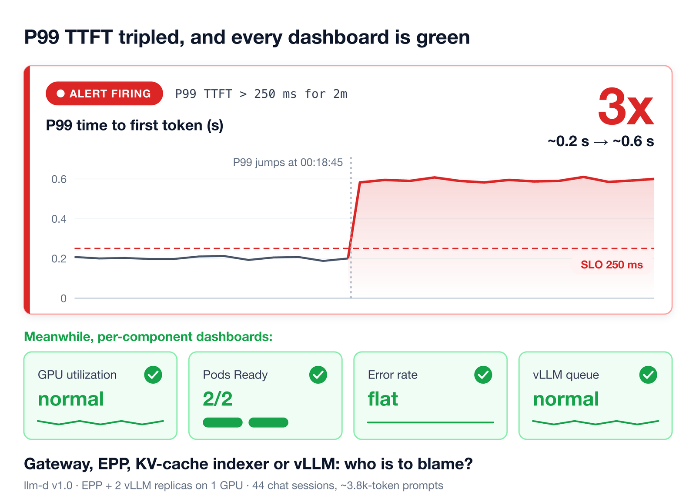

Everything is green. The setup is a real run on llm-d v1.0: a gateway, the Endpoint Picker (EPP), the KV-cache indexer and two vLLM replicas on one GPU, serving 44 chat sessions with ~3.8k-token prompts each.

So who is to blame: the gateway, the router, the KV-cache indexer, or vLLM? Without distributed tracing, nothing connects those components, and there is no error in the logs to grep for. That is true whether a human or an AI agent is doing the debugging.

We will come back to this incident and solve it at the end.

## 2. The system we need to observe

llm-d is a distributed LLM inference serving stack. Two features make it fast, and they are also what make it hard to observe.

**Cache-aware routing.** For long prompts like chat history, recomputing the KV cache is expensive, so vLLM keeps it in GPU memory across turns. Round-robin routing is blind to that cache. llm-d’s router sends each request to the pod where the prefix is already warm.

**Prefill/decode (P/D) disaggregation.** Prefill processes the prompt in parallel to build the KV cache and is compute-bound. Decode reads that cache to generate tokens one by one and is memory-bound. Running them on separate pods keeps heavy prefills from stalling active decode streams and lets each pool scale on its own.

Here is the path of one request:

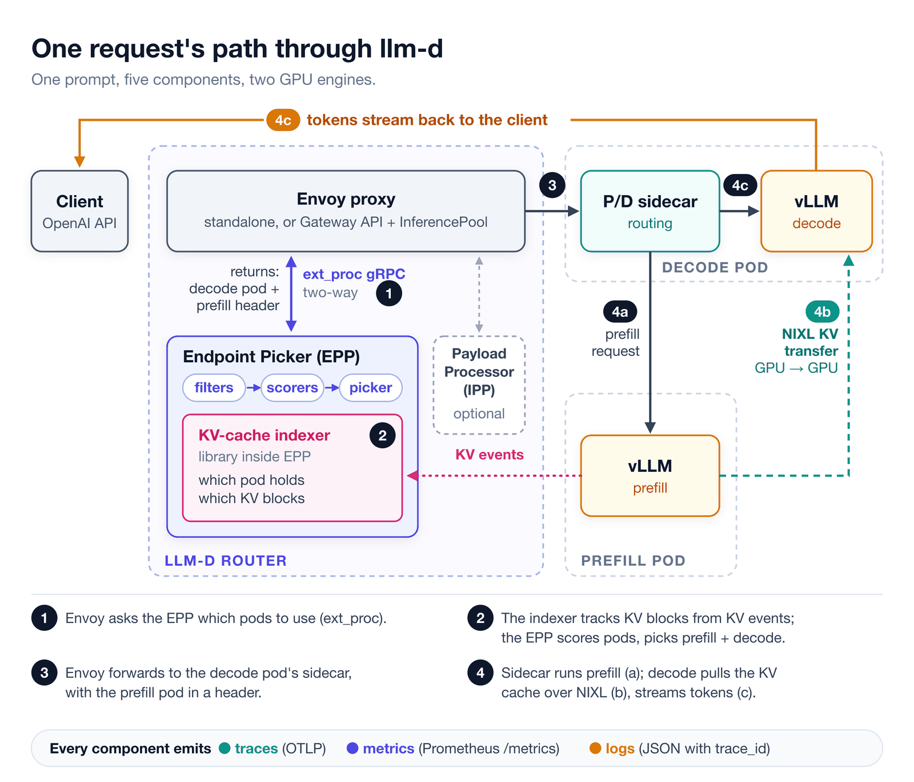

1. Envoy asks the EPP which pods to use.
2. The EPP’s KV-cache indexer listens to vLLM KV events to track which pod holds which KV blocks. The EPP scores candidate pods on prefix-cache hits and live vLLM load, and picks both a prefill pod and a decode pod.
3. Envoy forwards the request to the P/D sidecar on the decode pod, with the prefill pod’s address in a header.
4. The sidecar sends the prompt to the prefill pod, then calls the decode engine, which pulls the KV cache over NIXL and streams tokens back.

One prompt, five components, two GPU engines. That is why we need end-to-end visibility.

## 3. Three questions behind every slow request

Whenever an LLM request gets slow, you need to answer three questions.

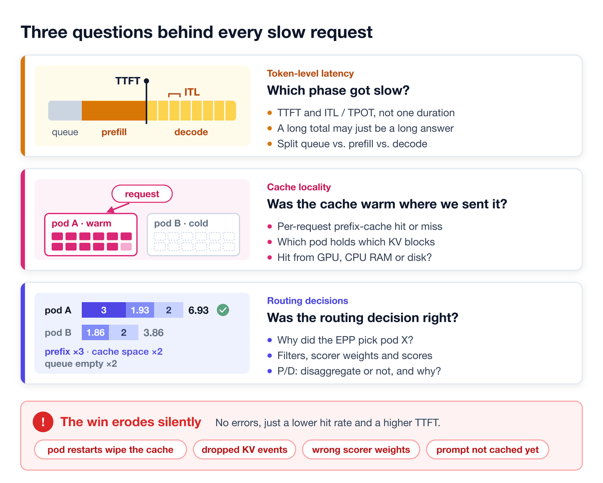

These questions matter because **the win erodes silently.** Pod restarts wipe the cache. KV events get dropped. Scorer weights are wrong. A prompt is not cached yet. None of these throws an error. You just get a lower hit rate and a higher TTFT, which is exactly the incident above.

## 4. Signals in llm-d: OpenTelemetry at the core

### 4.1 How llm-d uses OpenTelemetry today

Emitting components: **EPP, P/D sidecar, coordinator, KV indexer, IPP, batch gateway and vLLM.**

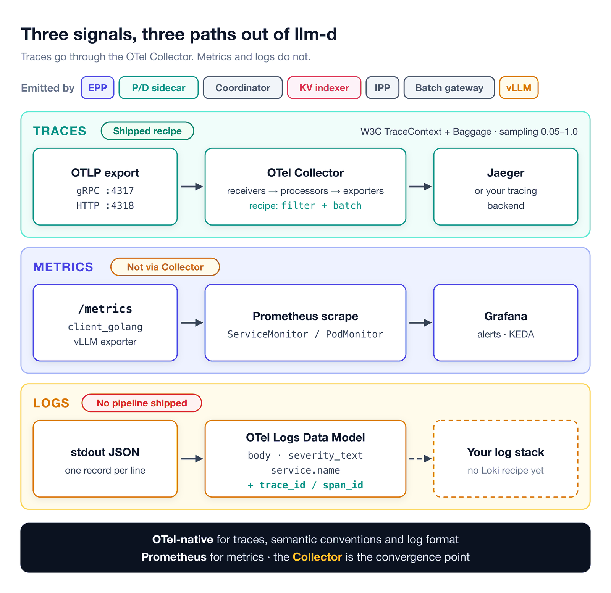

The quickstart ships an in-memory Jaeger so you can try it fast. For production, back Jaeger with persistent storage or point the Collector at your own tracing backend.

In short: llm-d is **OTel-native for traces, semantic conventions and log format**, uses **Prometheus for metrics**, and the **Collector is the convergence point.**

### 4.2 Semantic conventions: spans that speak llm-d

A default HTTP span says `POST /v1/chat/completions 200 OK`. That tells you nothing about tokens, cache hits or routing. So llm-d attaches structured attributes to each span, following OpenTelemetry semantic conventions across two namespaces:

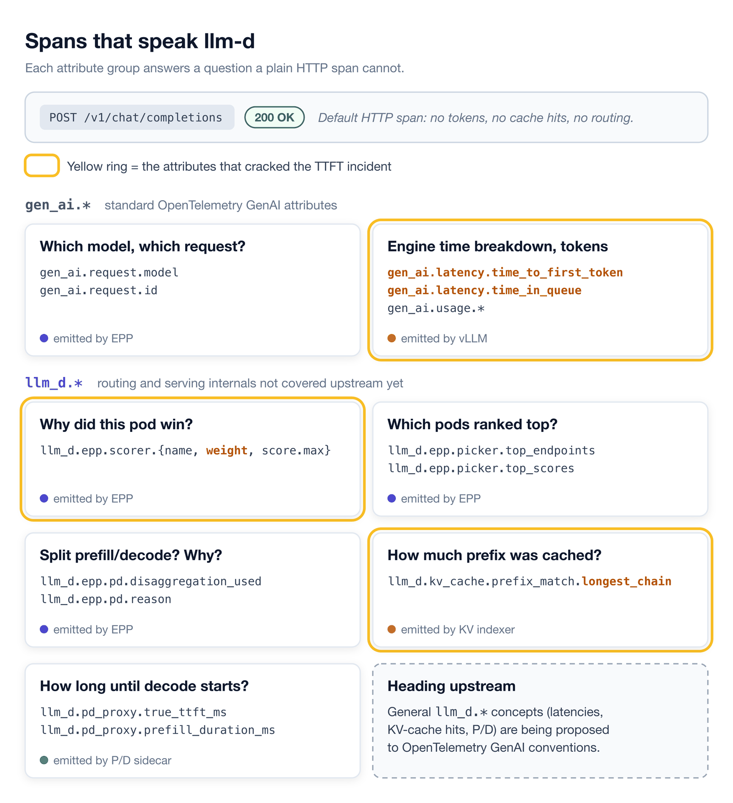

`gen_ai.*` covers standard OpenTelemetry GenAI fields. `llm_d.*` covers routing and serving internals that upstream GenAI conventions do not cover yet. Implementation-specific details, like EPP scorer weights, will stay under `llm_d`. For general concepts such as request latencies, KV-cache hits and P/D disaggregation, we are working with the OpenTelemetry community to standardize them upstream, so that vLLM, SGLang and other routers can share the same attribute names and your trace queries and dashboards work the same no matter which engine or router you run.

### 4.3 Metrics: golden signals per component

Traces explain one slow request. Metrics track the same golden signals across the whole fleet.

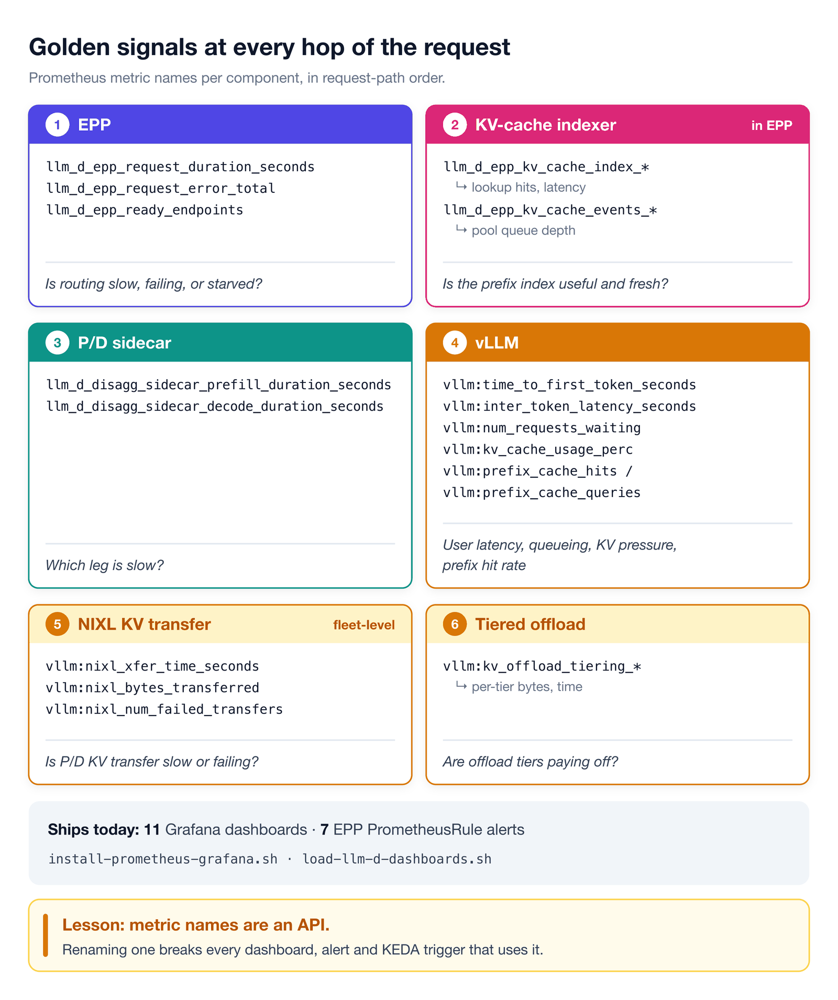

What ships as recipes today:

- **11 Grafana dashboards** (`llm-d-*`): router, tpu-overview, vllm-overview, sglang-overview, pd-coordinator-metrics, performance-kv-cache, failure-saturation-dashboard, diagnostic-drilldown-dashboard, batch-gateway-apiserver, batch-gateway-processor, batch-gateway-gc.
- **7 PrometheusRule alerts** for the EPP: `EPPHighErrorRatio`, `EPPCriticalErrorRatio`, `EPPNoReadyEndpoints`, `EPPMetricsAbsent`, `EPPDataLayerPollErrors`, `EPPDataLayerExtractErrors`, `EPPExtProcStreamErrors`.
- **Install scripts:** `install-prometheus-grafana.sh`, `load-llm-d-dashboards.sh`.

> **Lesson learned: metric names are an API.** Renaming one breaks every dashboard, alert and KEDA trigger that uses it.

## 5. End-to-end tracing

### 5.1 Anatomy of a P/D request trace

One request produces one trace across the router, the KV indexer, the P/D sidecar and both vLLM engines. Span names as in llm-d v1.0 (indent = parent/child):

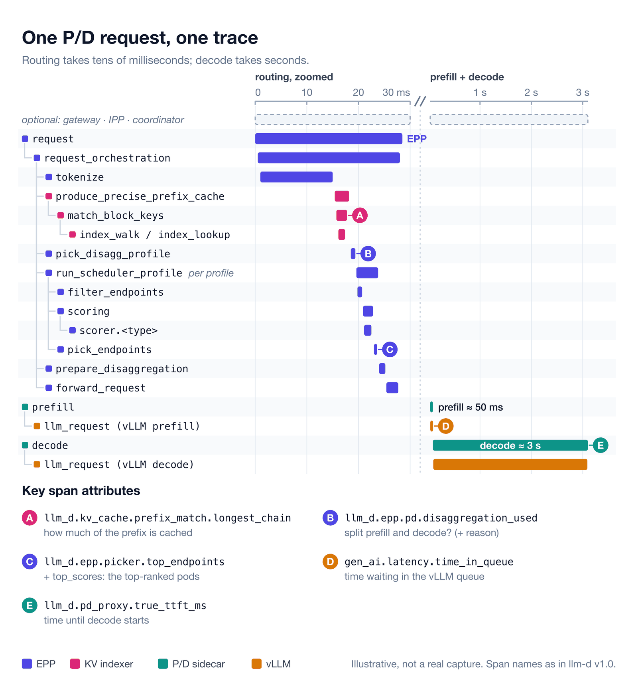

Routing is a tiny part of the request (tens of milliseconds out of seconds). Decode usually dominates the timeline.

### 5.2 What a healthy request looks like

Here is a real trace from the demo cluster (llm-d v1.0, EPP → vLLM with 2 replicas, prefix-cache weight 3, viewed in Jaeger):

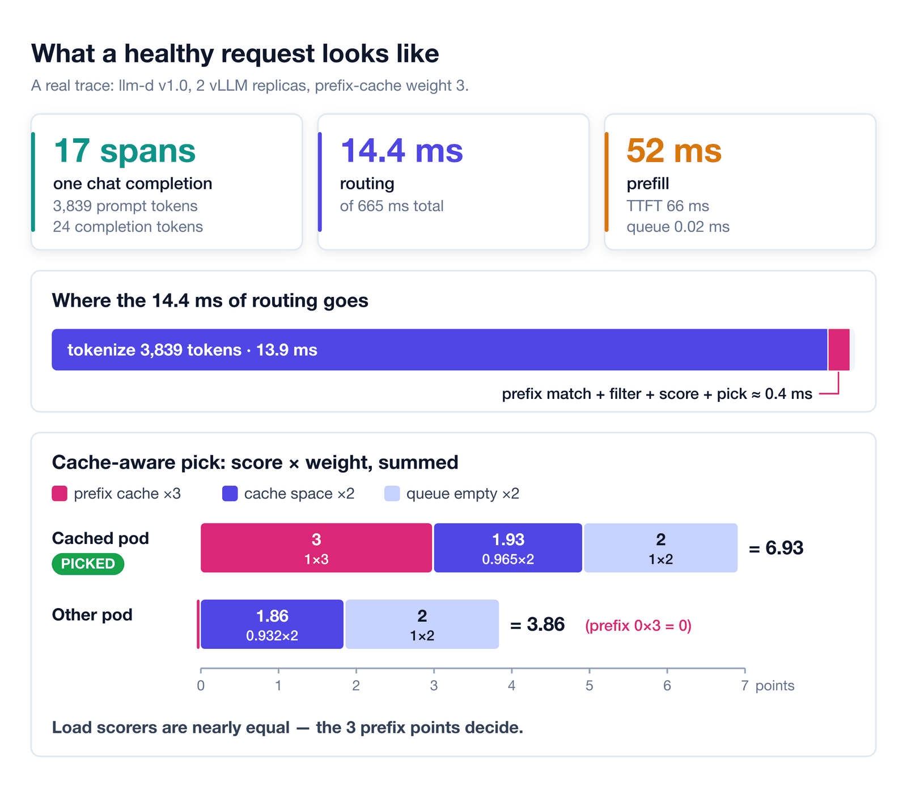

- **One request, one trace: 17 spans.** One chat completion with 3,839 prompt tokens and 24 completion tokens. Routing and the engine sit in the same trace.
- **Routing cost: 14.4 ms of 665 ms.** Tokenizing 3,839 tokens is 13.9 ms of it. Prefix match, filter, score and pick add about 0.4 ms.
- **Engine time: 52 ms prefill, TTFT 66 ms.** `time_in_model_prefill` is 52 ms for 3,839 tokens because this pod already holds the prefix in its KV cache. `time_in_queue` is 0.02 ms.

**Cache-aware pick.** Each scorer returns a score from 0 to 1. The score is multiplied by the scorer’s weight and summed.

Cache space and queue empty are load scorers: a higher value means the pod is more idle. Both pods are nearly idle, so the 3 prefix points decide. The cached pod wins, and prefill takes 52 ms. **Remember that 52 ms.**

**Overhead.** A common worry is whether turning on observability slows the cluster down. In our tests, turning on llm-d observability had no measurable impact on llm-d performance. The full results are in an upcoming blog post: [llm-d/llm-d.github.io#543](https://github.com/llm-d/llm-d.github.io/pull/543).

## 6. Correlation: metrics, traces, logs

### 6.1 The correlation triangle

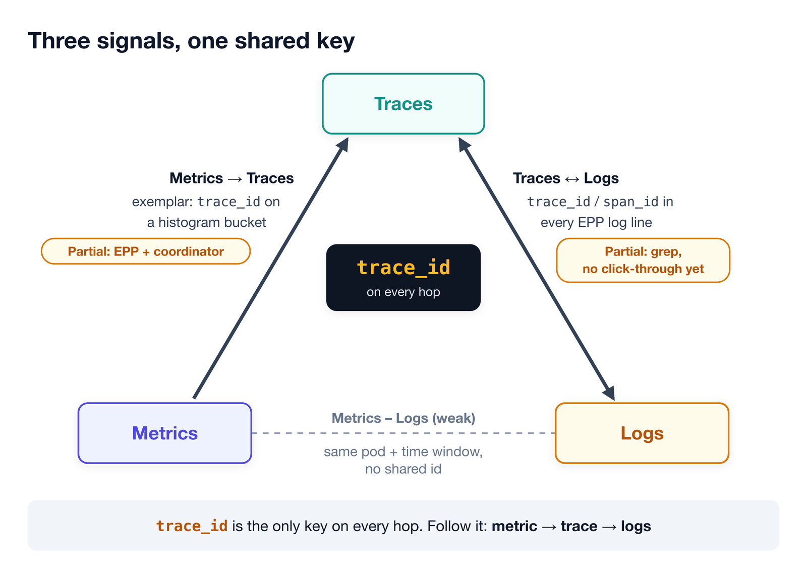

- **Metrics → traces:** exemplars put a `trace_id` on a histogram bucket. Partial today: EPP (and the coordinator) only.
- **Traces ↔ logs:** `trace_id` is in every Go log line on the request path. Partial today: no click-through in the UI yet.
- **Metrics → logs:** only by the same pod and time window, with no shared id.

`trace_id` is the only key present on every hop. Follow it: **metric → trace → logs.**

### 6.2 Metrics to traces: exemplars

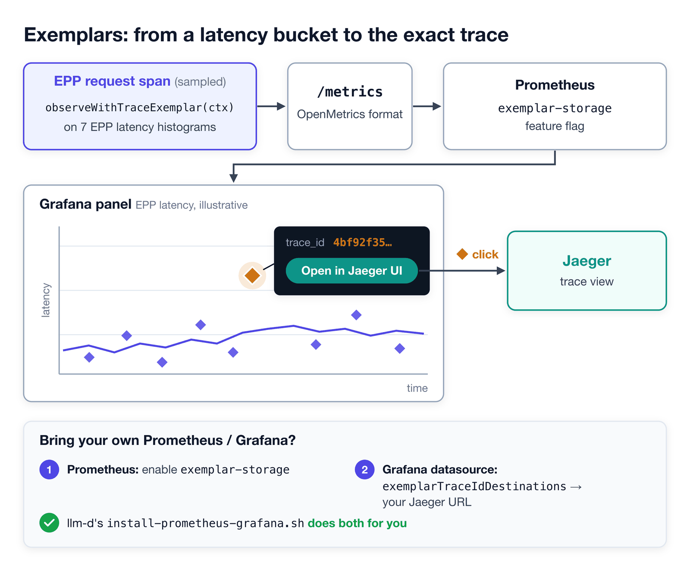

When the EPP records a latency, a helper attaches the current trace ID to the observation. The EPP serves these exemplars on `/metrics` in OpenMetrics format. Grafana shows them as diamonds on the latency panel. Hover over one to see its details, then click **Open in Jaeger UI** to jump to that exact trace.

If you bring your own Prometheus and Grafana:

1. Prometheus: enable the `exemplar-storage` feature flag.
2. Grafana datasource: set `exemplarTraceIdDestinations` to your Jaeger URL.

llm-d’s `install-prometheus-grafana.sh` does both for you.

### 6.3 Logs and traces

**What works today:** EPP request-path log lines carry `trace_id` and `span_id` in the OTel Logs Data Model:

```
{"timestamp": "2026-11-10T15:04:05.123Z",
 "severity_text": "INFO", "severity_number": 9,
 "body": "request scheduled",
 "service.name": "llm-d-epp",
 "trace_id": "4bf92f3577b34da6a3ce929d0e0e4736",
 "span_id": "00f067aa0ba902b7"}
```

*(Illustrative IDs. Tip: the message is in `body`, not `msg`.)*

So to get all the logs for a trace, grep for its `trace_id`.

**What you can’t do yet:**

- Click from a trace to its logs. No log pipeline ships, so you grep pod logs by hand.
- Find vLLM logs from a trace. vLLM logs do not carry `trace_id`.
- Find P/D transfer logs from a trace. Sidecar connector logs do not carry `trace_id`.

**How to close the gap (proposal, not shipped).** Run the OpenTelemetry Collector in two roles:

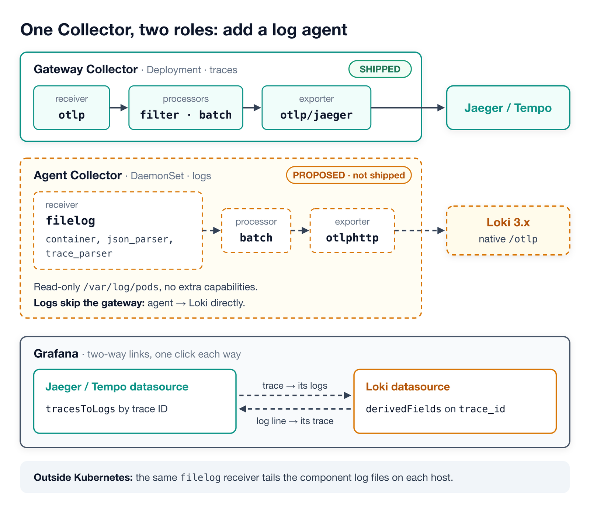

Then wire up Grafana for two-way links:

- Jaeger/Tempo datasource: `tracesToLogs` by trace ID. From a trace, one click shows all logs with that trace ID.
- Loki datasource: `derivedFields` on `trace_id`. From a log line, one click opens its trace.

The Kubernetes pieces (DaemonSet, `/var/log/pods`) are one way to collect the logs. Outside Kubernetes, the same `filelog` receiver can tail the component log files on each host, and the rest of the pipeline is unchanged.

## 7. Demo: solving the TTFT incident

**Setup:** llm-d v1.0, 2 vLLM replicas on one NVIDIA GB10. Exemplars ship in llm-d v1.0. The TTFT panel and vLLM tracing were added by hand. Full demo: [kubecon-obs-demo](https://github.com/gyliu513/langX101/tree/main/llm-d/llm-d-spark-full-demo/kubecon-obs-demo).

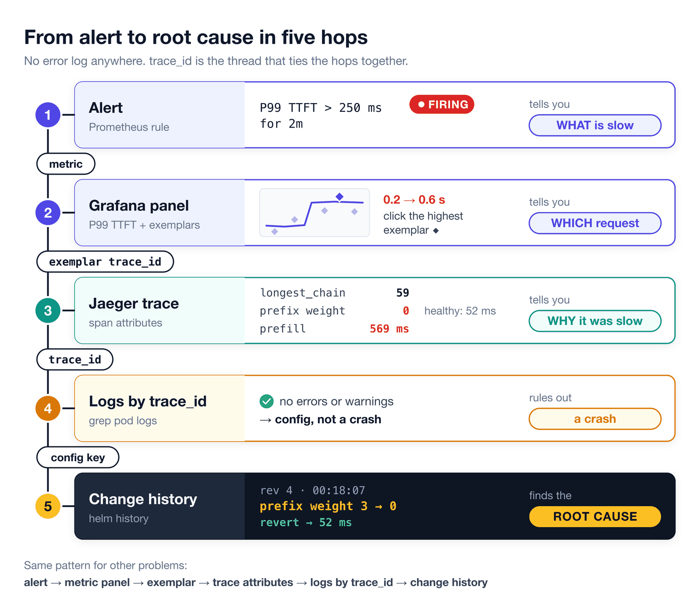

### Step 1: The alert fires

Prometheus fires: **P99 TTFT > 250 ms for 2 minutes.**

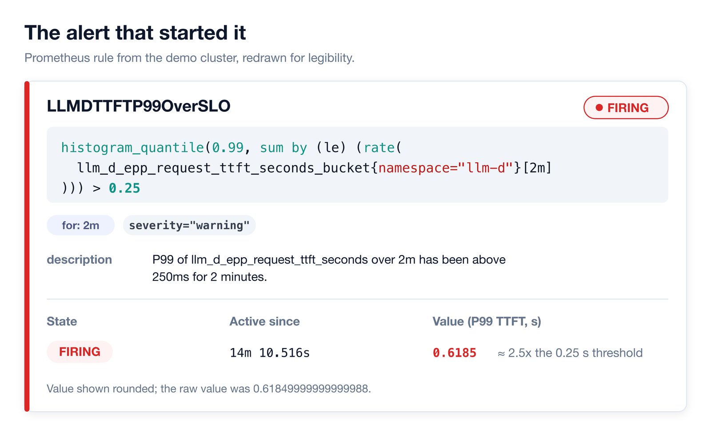

### Step 2: Grafana P99 panel

The P99 TTFT panel shows the jump from ~200 ms to ~600 ms. Hover over the highest exemplar diamond and click it.

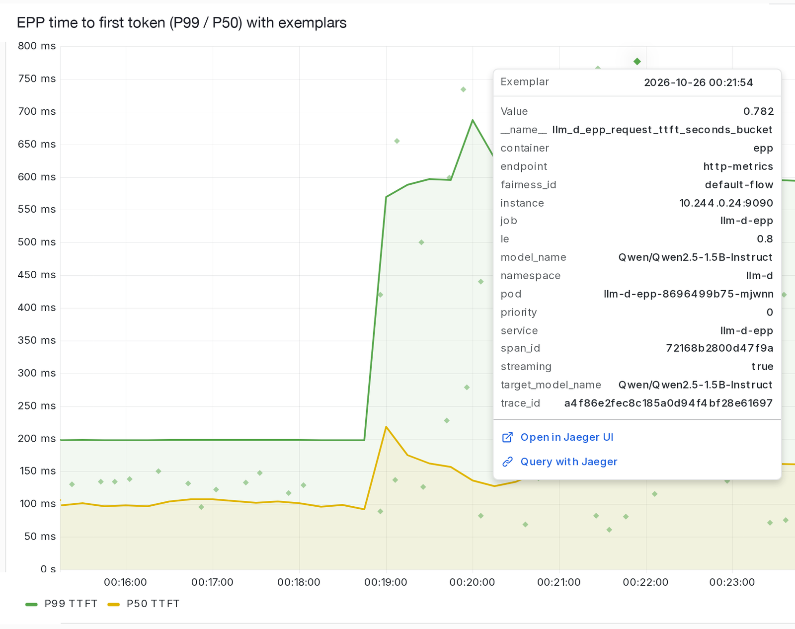

### Step 3: Jaeger trace

The exemplar opens the trace for one of the slow requests. Three attributes tell the story:

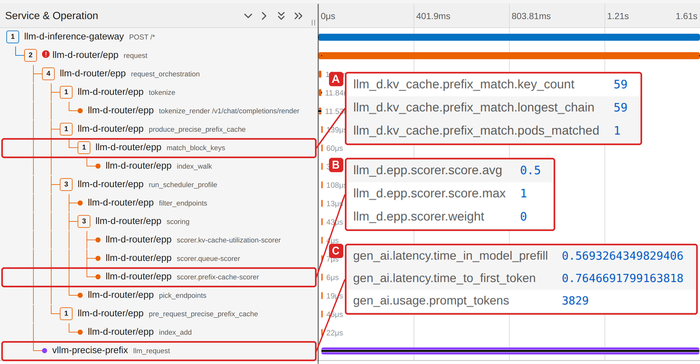

- **A.** `llm_d.kv_cache.prefix_match.longest_chain = 59`, `pods_matched = 1`. The whole prefix is cached, on one pod.
- **B.** The prefix-cache scorer `weight = 0`. The cached pod loses its 3 points, and the other pod wins 3.93 vs. 3.86.
- **C.** vLLM prefill takes **569 ms** for 3,829 tokens. That is about 11x the healthy 52 ms. The pod recomputed the whole prompt, because the request did not land on the pod with the cache.

### Step 4: Logs by trace_id

Grep the logs for the trace ID. There are no errors or warnings for this request. The EPP worked as designed: it made a normal decision with a bad config. This is a config problem, not a crash.

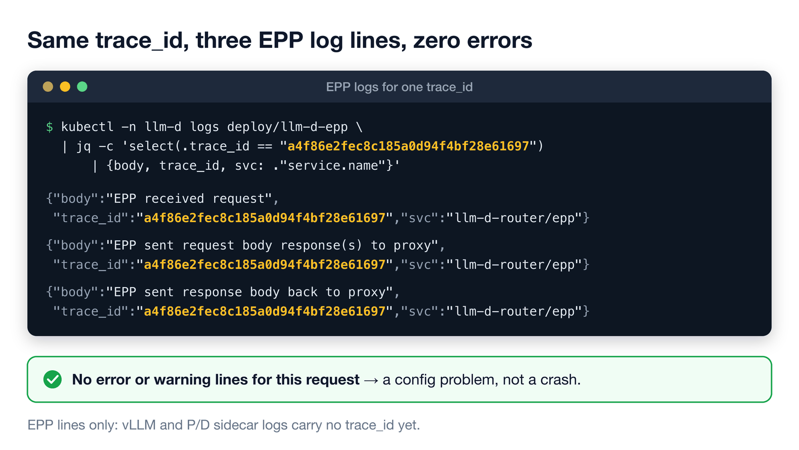

(Only EPP lines show up. vLLM and P/D sidecar logs do not carry `trace_id` yet.)

### Step 5: Root cause

The scorer weight is EPP config, so check its history with `helm history`:

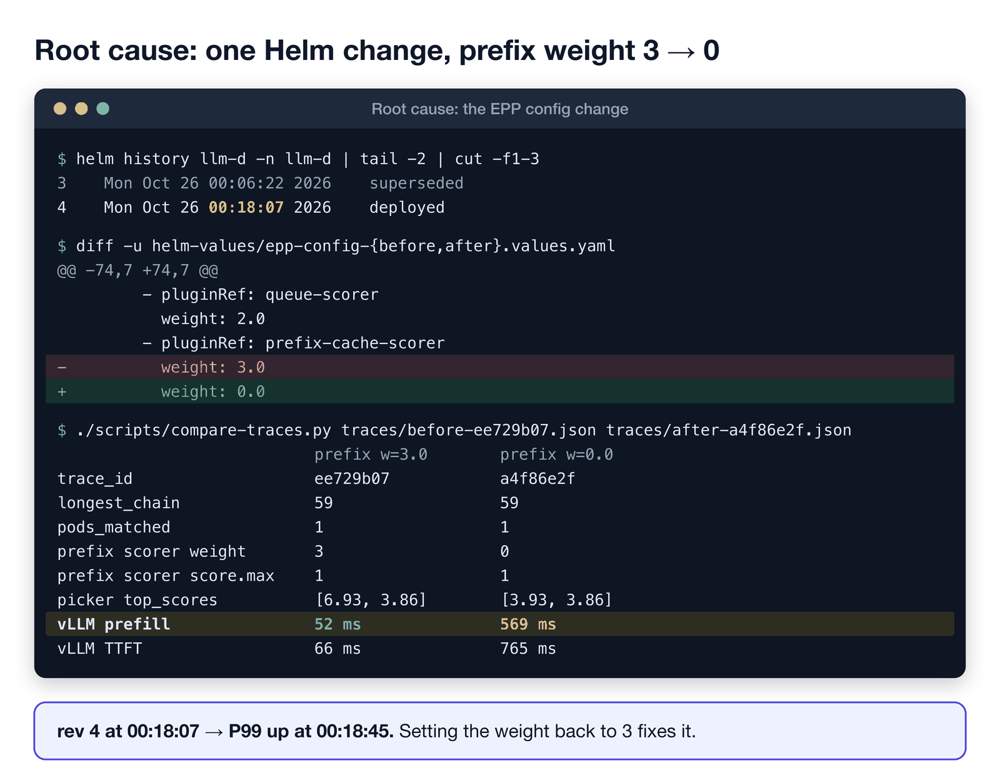

- Revision 4 at 00:18:07 changed the prefix-cache weight **3 → 0**.
- P99 went up at 00:18:45.
- Prefill went from 52 ms to 569 ms. Setting the weight back to 3 fixes it.

That is the TTFT spike from the start of this post, explained.

**Good vs. bad trace, side by side:** two different chat sessions with the same kind of prompt (~3,800 tokens, fully cached on one pod, 59 blocks matched on one pod in both cases).

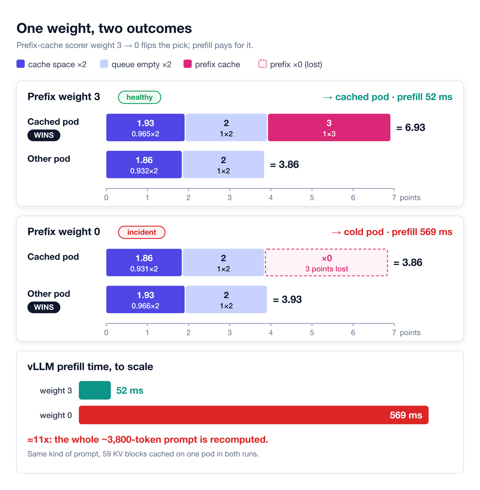

A cold cache is a symptom, not always the cause. Other causes to rule out with the same workflow: the cached pod restarted, competing traffic evicted the KV cache, or KV events were lost so the index is stale.

The same pattern works for other problems: **alert → metric panel → exemplar → trace attributes → logs by `trace_id` → change history.**

## 8. What’s next

Coverage by component (checked against llm-d `main`, November 2026; not all of it is in a release yet):

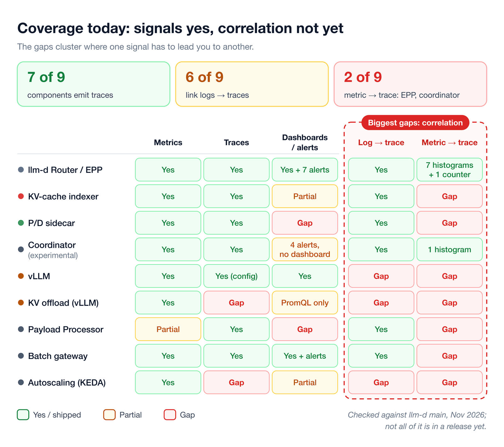

Today: traces in 7 of 9 components, log → trace in 6, metric → trace in the EPP and the coordinator.

The biggest remaining gaps are in correlation:

- **Logs ↔ traces:** ship a log pipeline (the Collector agent described above) so you can click from a trace to its logs and back in a dashboard, and get `trace_id` into vLLM and P/D sidecar logs.
- **Metrics → traces:** extend exemplars beyond the EPP and coordinator to the KV-cache indexer, the P/D sidecar, vLLM and the other components.
- **Semantic conventions:** upstream the general `llm_d.*` concepts (latencies, KV-cache hits, P/D) into OpenTelemetry GenAI conventions.

## Join SIG-Observability

- **Slack:** `#sig-observability` on the llm-d Slack
- **Code:** [github.com/llm-d/llm-d](https://github.com/llm-d/llm-d)
- **Start here:** issues labeled `good first issue`
- **Web:** [llm-d.ai](https://llm-d.ai)
